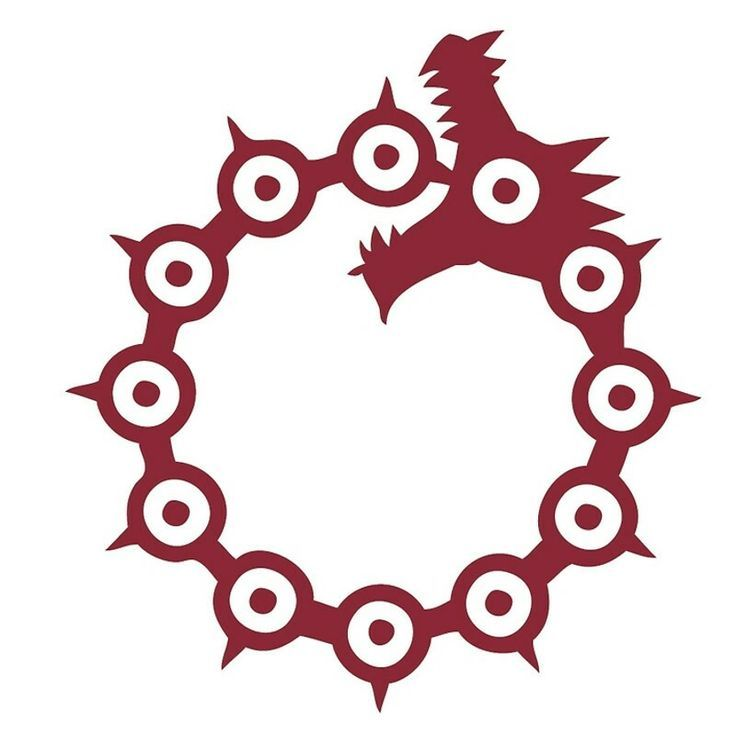

A promise is a promise. Here's the second part of this series of articles about my experience getting back in shape. I'll be as brief and non-technical as possible so we can all understand and take in the content the same way.

This time we're diving straight into a few topics that were important for getting my results. These were:

- Intermittent fasting
- Eating more fat to lose fat

First things first, guys. Keep an eye on the following before going on:

>**This was my experience**...
>
> You probably think that since these recommendations went well for me, they can go the same way for you. Let's remember that every body responds differently. We are a world of opportunities and consequences based on our circumstances. My recommendation is that you take my experience and my results as a baseline for yours. It's highly recommended that you look for professional advice. I'm just someone passionate; someone who loves learning and sharing knowledge.

## Intermittent fasting

In recent years there have been countless studies showing the validity and great benefits of intermittent fasting. But in short, what exactly is this?

In a few words, intermittent fasting is an **eating pattern** that cycles between periods of fasting and eating. That said, this leaves just one thing *implied*.

> Intermittent fasting is not a diet. It does **NOT** mention what you should eat, but it does stipulate when you **COULD** do it.

It's claimed that by following this pattern, your body will start to behave differently... for example:

### Are you diabetic? 
It would be a good idea to follow this pattern. It's been shown that insulin levels drop to the floor (literally) when doing intermittent fasting.

### Do you want to gain more muscle or lose fat?
There are studies that mention that the presence of growth hormone is more noticeable with this eating pattern. A high level of growth hormone translates into greater gains in muscle mass and loss of body fat.

### Do you want to detox?

When you go into periods of intermittent fasting, your body enters a process called **Autophagy**.

>The word means being a cannibal and that you should eat your own arm so it grows back more muscular... ¯\\_(ツ)_/¯

Back to the topic, autophagy means *Eating Oneself* and it's a mechanism by which our cells begin a state of degradation, and these, in order to survive, start to *recycle* damaged structures inside themselves such as proteins and other components of their own, managing to lower our risk of catching some virus, bacteria or even degenerative diseases because of these degraded compounds.

It's been shown that the easiest way to enter autophagy is simply by fasting.

### Do you want more money and more time?

> Think about it... you could skip meals. You spend less money and time on food. ¯\\_(ツ)_/¯

### Some intermittent fasting techniques

Fasting is simple, it's just not eating (* *cough, cough* *). However, we need to find the method that feels most comfortable to us. Because we also want to avoid having anxiety in the process or other side effects. It's worth mentioning that it's fine to have drinks like coffee, tea and water or any other drink considered non-caloric; but let's try not to overdo it. If you use any sweetener in your drinks, make sure it's non-caloric like Stevia or another artificial sugar.

Here are a few methods:

- **16/8 method** (easy): it consists of skipping breakfast and having an 8-hour eating window. Once this window is over, you go back into your fasting period for 16 hours. This is the most recommended one for beginners and it's recommended that women do periods of 14 to 15 hours. This method is flexible so you can shorten your fasting periods to something like a 12/5 or 14/6 and work your way up.

- **Eat/stop/eat** (very hard): I'll tell you right now that I don't recommend this one. This is a fast for a 24-hour period once a week. If you're one of the brave ones, you can do it twice a week. A simple way to do it is to have dinner and then eat again at dinner the next day.

- **5:2 method** (intermediate, well, depends on how you look at it): in this one, you should only consume 600 calories a day, daily. Personally, I recommend this one even less than *Eat/stop/eat*; because you'll have to keep intensive track of what you eat that day and I think that's much harder for most of us.

#### In my experience...
I do the 16/8 period. It was a nightmare at first, the anxiety was unbelievable; especially for me since I'm quite a glutton. But after a few days everything started to calm down. Throughout the whole process, I keep myself company with coffee, green tea and a ton of water (a bit more than 4L) during those periods (with no sugar or with Stevia sugar). So far, I've felt great with my results and energy.

## Eating more fat to lose fat
*Dude, how come?* 🤔

Fats are demonized. You go to an average nutritionist and they tell you to avoid them, you look up any Youtube video and they vilify everything with the word *fats*, you ask the jacked guy at the gym and he'll probably tell you that if you want abs you have to avoid fats. However, there's one small detail that all of these examples miss...

 > Eating fats is not the same as storing them. Why?

The process by which our body burns fat is simple and complex at the same time. In the first place, glucose is the primary source of energy. When glucose runs out in the body, our organism will look to turn fat reserves into energy; this is when your body starts to enter what's known as a _ketogenic_ state. If you don't eat energy-dense or fat-rich foods our body will adopt a protocol typical of a state of emergency, and this is when it will pull from its own reserves stored for times of need.

Subjecting our body to these measures will force us to burn through a large part of the fat reserves we had accumulated in the organism. But, despite losing the fat, what we'll be doing is causing our body to store more fat again in the future as soon as it gets it through food (something like a rebound effect), because by triggering this state of emergency the organism will hold on to fat for other similar occasions.

This is easily avoidable; to keep it from happening we need to keep in mind the importance of getting fat through our diet, since it's a necessary nutrient for the body to work properly. If fat is included in our diet, our organism will function normally, although there's no need to go overboard with the amounts we eat, because that way what we'll do is tend to accumulate that surplus in the organism, making our volume increase.

It's worth saying that not all fats are recommendable. In fact, there are several types of fats in the world and they're the following ones I show you:

-   **Saturated fats**: their main characteristic is that they're solid at room temperature and they're found in foods of animal origin. Have you seen a steak with bits of white fat on it?; then you've probably seen saturated fats. Avoiding these fats is the first thing a doctor recommends when you suffer from high blood cholesterol levels.

-   **Monounsaturated fats**: these fats are liquid at room temperature and the body can't synthesize them, which makes them an essential fat. Unlike saturated ones, consuming them can lower cholesterol. In olive oil, this type of fat is abundant.

-   **Polyunsaturated fats**: this fat ***is a fat***!, it splits into two links which are **Omega 3 and Omega 6**. Omega 3 fatty acids can also be called linoleic acids; they're abundant in fish, nuts and seeds; there are hundreds of studies that back their consumption. On the other side are Omega 6 fats, which are present in some nuts, margarines and sardines. Certain studies mention that moderate consumption of the latter plus daily physical activity brings benefits to the body. But on another note, there are several studies that associate the consumption of Omega 6 fats with cardiovascular diseases (although these studies are somewhat controversial).

-   **Trans fats**: basically they're unsaturated fatty acids that have been turned transgenic through a technological process of hydrogenation or oil refining. Overdoing them raises cholesterol levels and affects cognitive processes. If you're one of those who wakes up and picks an Empanada, a Croissant, Cupcakes, etc. for breakfast; you're a trans fat consumer. By now, you know why we should avoid them.

**I already mentioned some within the types. Now, how have I handled fats in my day to day?**
  
- I prefer fresh foods over processed ones because the latter usually contain hidden fat you don't want.
- I use olive oil instead of vegetable oil; the latter is highly refined by the industry so it's not healthy. Every now and then, I use coconut oil; anything I put coconut oil on gets a different touch... *galactic*. If you're someone who likes having new experiences on your palate, you could try this last one.
- Eat more foods rich in monounsaturated fats. Here are some I've tried and love:
  -  Avocado  
  -  Almonds
  -  Cashews
  -  Sunflower seeds
  -  Raw or roasted peanuts
  -  Peanut butter
  -  Almond butter
  -  Walnuts

- I'm terrible at eating fish. As a kid I had a bad experience with some bones and I've been somewhat afraid of eating it ever since. To get the benefits of fish fats, I've bought fish oil. However, I've fought with myself and I usually eat a can of chunk Tuna (not flaked) in water or Olive oil and it's worked out great for me. You can combine it with a clove of garlic, oregano and salt to taste (in moderation) in a skillet... a succulent delicacy fit for the gods.
- Whenever a bit of anxiety starts nagging at me, I have roasted peanuts or almonds with me at home. Peanuts are super affordable and cheap, especially if you buy them raw and roast them yourself; it takes about fifteen minutes and it's just stirring them constantly. There's no need to add salt either (their fats give them an exquisite touch). Besides, you can combine them with literally everything... you can eat peanuts with salad and meat at lunch (**peanuts are a legume like beans**), it's not something crazy but it is rare to see. Just in moderation, though. Legumes are highly caloric, if you want to lose weight and you're a peanut lover you should eat them in moderation.

    As for almonds, my recommendation is to buy them at supermarkets where the products are imported or that are mostly membership supermarkets (like Pricesmart); nuts come out much cheaper there.

As you can see, I've talked about two very controversial topics. People tend to say that fasting is simply not eating and that it isn't healthy, and on the other hand, many of us used to say that you should avoid eating fats if you want to lose the ones you have stored. All of this is partially correct. Let's always remember that the **results are in the balance**.

There's no point in fasting for 48 hours, losing all your body fat and on top of that losing muscle; there's no point in eating 2kg of peanuts, pouring all the olive oil on your Beef steak now that you know Olive oil and other fats can help you lose weight. If you want to lose fat, you have to be, one way or another, systematic and objective and moderate with **what you eat**. Whenever you want to lose weight, you have to create a caloric deficit (consume fewer calories than you burn)

##### In the next part (3), the only topic I'll cover is exercise; both outside and inside the gym and some that I do right when I wake up. Stay tuned, because there's a looooot more to come.

##### 🥳
