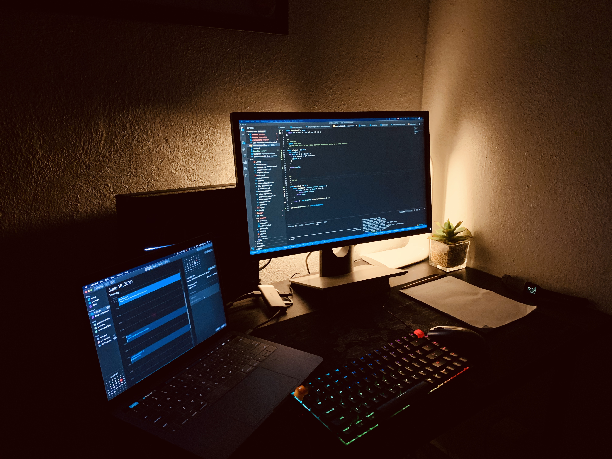

# Let's see

It's not unusual in the programming field to burn out or, as it's popularly known, _hit burnout_ and lose the passion for our work. You only need to browse a site like Stackexchange for a bit and search for the term burnout, and you'll notice there are hundreds of questions that act as evidence that this is a real problem and above all a very normal one in the software industry and, without going too far, in the whole IT industry.

### But why does this happen?

Honestly, I don't know. What I do know for sure is that in our field this happens much more often than in other areas. However, in my humble opinion I think there could be a few reasons why this happens to us...

### Your habits

Look at it this way... you get to work, you sit at your desk, or maybe you're remote and you just get out of bed and go to your work table. Being in front of the computer every day is certainly not healthy; it makes you feel more lethargic, bored, you turn into an undead. Lethargy can also lead to other not-so-good habits like eating all day anything that has to do with ultra-processed products like a bag of air with some chips in it, indulging in anything that stimulates the nervous system, staying up late and so on. In the long run, all of this makes you resent what you love.

> Do the memes about developers with coffee or about us being gargoyles ring a bell?

### Passion can be a double-edged sword

We love programming, we love thinking about how to solve the problems we face day to day in our career; we love seeing that CI running all the tests and seeing them marked as passed, we find satisfaction in moving a little card with the description of a problem from one column to another and above all; we love it when we see an email telling us that little card now has a label called "deployable". However, all of this can take **too much energy** from us. Programming is a highly intensive and stressful job from a cognitive point of view, and of course, at some point...

> Mental fatigue always comes to collect.

### You're not passionate about what you do but you keep programming

It could be that you're exhausted because the work you do is, in fact, boring and unrewarding for you. It's exactly the opposite of being someone passionate. You melt down over the fact that you're doing something you would never do without money involved.

> Take some time off and ask yourself, would you sit down to program a project for someone without thinking about money as a main factor?

### We are negative people by nature

> [Burnout is caused when we repeatedly make large amounts of sacrifice and/or effort on high-risk problems that fail. It's the result of a negative prediction error in our Nucleus Accumbens (a part of our brain that allows us to "think"). Naturally, we condition our brain and its way of thinking to associate work with failure](https://news.ycombinator.com/item?id=5630445)

Do you agree?... Not a day goes by without failures happening in the creation of software, our job consists of creating those failures, on purpose or not, and eventually having them fixed. Perfect software doesn't exist.

### Anyway

I've run into burnout several times myself. None of those times made me quit programming for good (Hellooow, I love programming), not even for a full month, but at least it made me doubt over and over whether I chose the right profession. Since then I've become more strategic in the way I work to stay motivated and productive in the long run.

Here are some tips and techniques that are basic and apply to everyone, even if you're not in IT as such.

### Starter kit to avoid burnout

1. **Eat well**. It's not like you have to become a vegan either. Small steps make the difference, like drinking water instead of soda; add more complex carbohydrates and vegetables to your diet; eat regularly and don't overeat. These are the fundamentals that will make you see a good difference. You can also try [Intermittent fasting](https://giancastle.com/asi-perdi-30lbs-2/) as I explained in my weight loss post.
2. **Sleep well**. That includes getting quality sleep and enough of it. There are many things you can do to create a better sleep environment and wake up fresher (starting with eating well, for example). One specific tip for programmers regarding sleep is to reduce exposure to blue light, which can keep you awake at night. This can be done by installing [Flux](https://justgetflux.com/), which makes the color of your computer screen adapt to the time of day; although this already comes built into many devices.
3. **Don't overwork**. This may sound unnatural to those of us who love programming but, it's been shown time and again that productivity, which in this case refers to the production of source code, drops brutally after four hours of focused work. It's almost impossible to stay productive in a job as cognitively intensive as programming over the long term.
4. **Move. Don't be an undead**. If you know me, you'll think I'm going to tell you to go to the gym and work out there, but a lot of people have the wrong idea about it, thinking exercise has to involve going to the gym and so on... In reality, staying active is a matter of simple tradeoffs; choosing the stairs instead of the elevator, parking the car in the farthest corner of your favorite mall; taking the metro and walking a few blocks to work and finding other ways to build movement into your daily life will make you feel better and not feel trapped in front of the computer all day.

### Pro-tips for developers

1. **Do new things, experiment**. It's very profitable and productive in the short term to do what you do best. For example, keep building websites the same way you always did. However, over time it becomes boring and a soul sucker. Programming is partly a creative process and partly engineering; also the use of well-proven techniques to produce software. But, it's also about having fun, experimenting and trying new ideas. Deliberately dedicating 20% of your time to playing with technology is one of the most effective strategies to avoid burnout. Create something fun and unrelated to work, or turn the negative into a problem (I witnessed the millions of Covid-19 trackers that popped up this year, I was also guilty of adding one to the list) or invest time in learning something outside your comfort zone, like functional programming (If you know me, you know why I mentioned this).
2. **Connect with others. Listen to what others have to say**. Programming can be lonely. Meeting other developers, or listening to their experiences on podcasts or videos helps you not only stay in the day to day, but also be more attentive to your work. Nobody likes complaints, but sharing, or listening to the struggles of other programmers, is reassuring and can be motivating if you hear how others overcame their struggles.
3. **Take a break and allow yourself to pursue other passions.** There are many interesting activities besides programming. Guess what... sports, cultural events, sex, reading, socializing, hiking, barbecues, photography, etc. If you keep doing just one thing all the time, like programming, one day you'll inevitably wake up burned out and hating yourself for not having a life. Besides, doing something seemingly unrelated to your "real" job could rekindle your passion and spark new ideas.
4. **Consider changing jobs, slightly shifting your areas of interest or switching to a different project**. It could be that you're stuck doing uninteresting, soul-sucking work at your current job, like doing little things on an existing codebase all day long. Or maybe the project you work on is no longer aligned with your interests or values. Also, if you find that programming no longer excites you, take a look at relevant fields like information architecture, systems administration, etc., which may line up better with your passions.
5. **Don't be cheap with your work tools**. As software developers, we spend a lot of time sitting at a desk so a good way to make this more pleasant is to indulge our needs and certain whims to improve our productivity in front of a monitor. Get the PC that compiles fast and doesn't make you wait or maybe... buy yourself a Mac. Make sure you have a chair, a table and monitors that are comfortable and well placed. If you work in a noisy environment, invest in high quality headphones that block out noise, letting you be in silence if needed.
   

### All in all...

There's no standard cure for burnout, since everyone's case is unique. However, the things I mentioned have worked for me, and I hope they work for you too.

I admit this is a whole phone book and the list of tips is kind of long and it takes time to develop new habits. And although eating healthy, sleeping well, exercising and taking care of yourself in other ways will help you feel better, perform better at your job and keep alive the love you once had for programming, for most programmers it all comes down to the basics.

And that... **requires having a life**. Don't mentally masturbate thinking you have to work 10 hours a day, 6 days a week. It's scientifically proven that performance drops drastically after a while, I already mentioned it. So, stay focused and effective while you work, and then switch off completely after work. Learn to say no and do something you enjoy besides programming. That really is tip #1, and it always will be.

