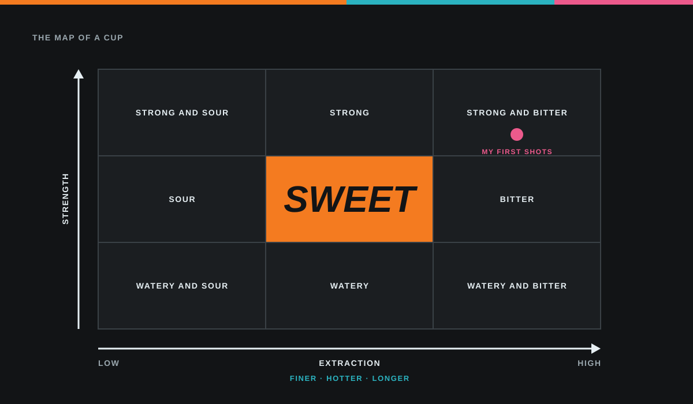
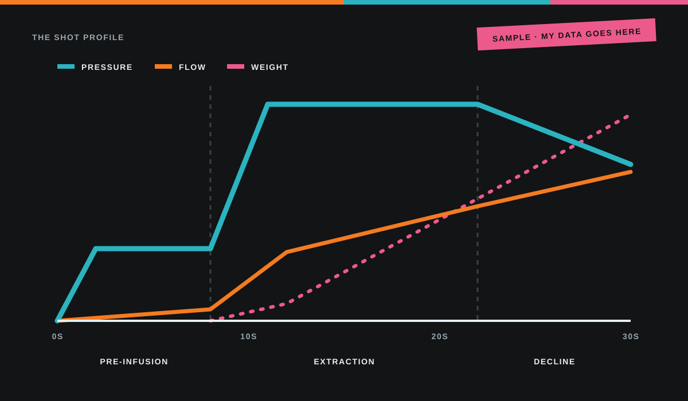
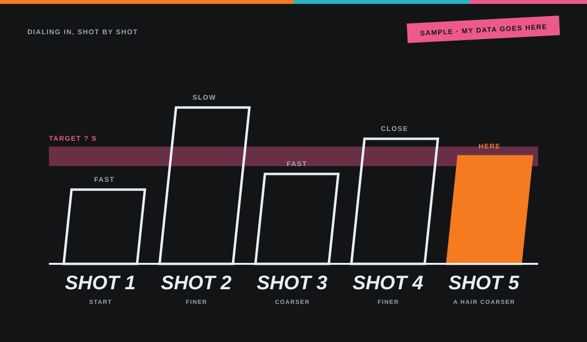

Something funny happens at my place. People drop by "just to say hi" and five minutes later they're asking if there's coffee. And I don't mean only the coffee people... I mean the ones who tell you to your face that they don't like coffee (and still drink theirs, and sometimes ask for another).

That coffee has a name. It's the **Rancho Arriba from Été Café**, and in this post I'll tell you how I got it to a sweet, soft espresso, gentle enough that I could finally pour milk over it and make a latte or a cappuccino without losing it on the way.

> Draft notice. Anything marked <mark>like this</mark> is a detail I still have to fill in, and the charts with the pink tag are samples.

## So, what coffee is it?

Rancho Arriba sits in San José de Ocoa, up in the mountains, and it's one of the known coffee regions of the Dominican Republic. That's where this coffee comes from.

<mark>Q1 · What the bag says. Roast level, tasting notes, process, variety and altitude.</mark>

What got me was <mark>Q1 · why I picked this coffee and not another</mark>.

## The problem with a light espresso

Look at it this way. An espresso is hot water pushed through ground coffee for a few seconds, and in that time it has to take the good stuff out of the bean. Take too little and the cup turns **sour** and thin. Take too much and it turns **bitter** and dry. Sweet lives in the middle.

With a light roast the challenge is bigger, because the bean is denser and gives up less in the same time. That's why it's so easy to end up in the sour corner of the map. And milk doesn't forgive that. A sour shot with milk doesn't taste like a latte, it tastes like something went wrong.

That's what happened to me at first. <mark>Q5 · How my first shots tasted and what happened when I added milk.</mark>

## The recipe

After a few attempts, this is the recipe I stayed with.

<mark>Q3 · Dose, grams in the cup, time and temperature. Also the basket I use.</mark>

Why those numbers? <mark>Q3 · The reason behind the recipe, for example a longer ratio or hotter water.</mark>

## The shot profile

A recipe tells you where the shot ended. The profile tells you **how it got there**. It's pressure, flow and weight second by second, and it's the chart the espresso world uses to explain itself.

<mark>Q2 · My machine, my grinder and my scale, and whether any of them gives me this curve.</mark>

<mark>Q4 · Whether I use pre-infusion or any pressure or flow trick, and what it does to the cup.</mark>

## Dialing in is debugging

This is where the engineer in me shows up. Dialing in an espresso is the same as debugging. You change **one thing**, run the test, read the result and decide the next change. Change three things at once and you learn nothing (just like in code).

<mark>Q6 · What I changed, in what order, and how many shots it took to get there.</mark>

> Measure, don't assume. It works for a color contrast and it works for a cup of coffee.

## Sweet and soft

And how do I know I got there? Because the cup changed shape.

<mark>Q7 · How it tastes now, in my words, and a 1 to 10 score on each attribute for the first shot and the good one.</mark>

## And finally, the milk

This was the goal from the start. Steamed milk brings sweetness and body, but it also covers things up. If the espresso arrives weak, it disappears. If it arrives sour, it fights the milk. It has to arrive sweet and with enough character to be felt **behind** the milk.

<mark>Q8 · Which milk I use, how much, whether it's a latte or a cappuccino, and what didn't work before.</mark>

And here the people from the beginning come back. <mark>Q9 · The story of someone who doesn't drink coffee and drank mine, and what they said.</mark>

## That's it

I'm not a barista, I'm someone who loves understanding why things work. And what I take from this is that good coffee isn't guessed... **it's measured, tasted and adjusted**. One thing at a time.

If you drop by, you know what's waiting.
