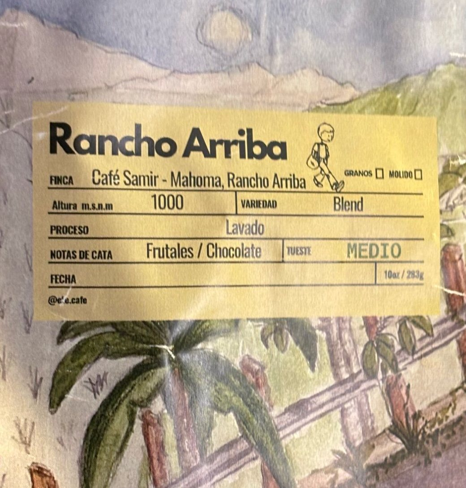
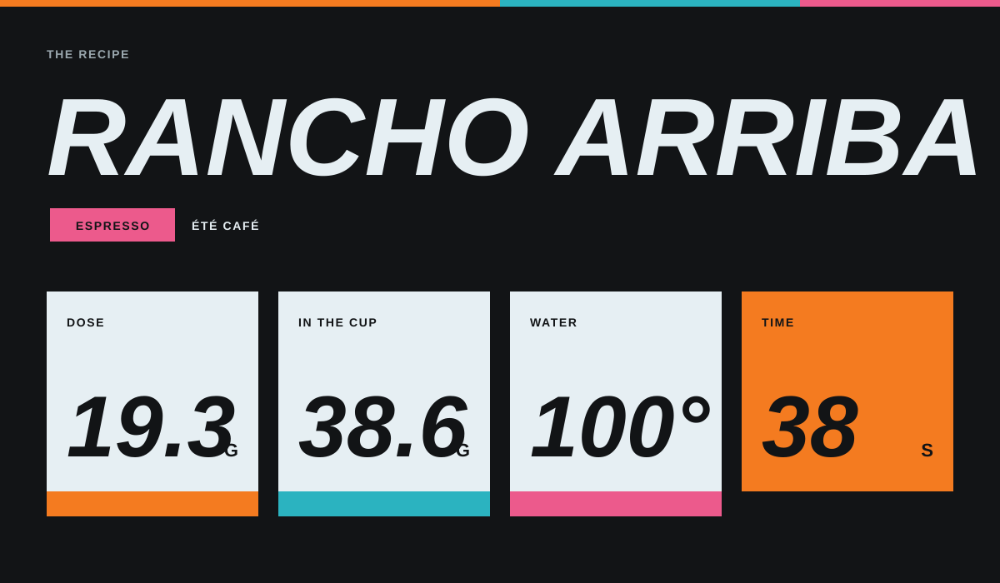
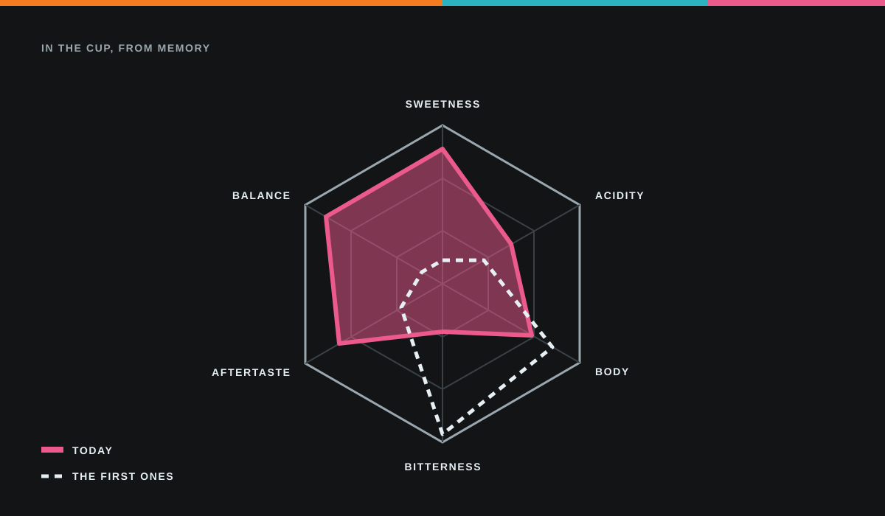
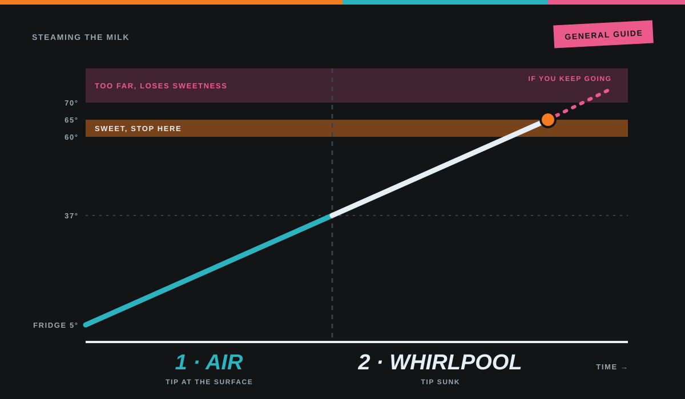

I'm fundamentally crazy about three things... coffee, cycling and software.

This post opens a special section of the blog, the [Coffee stop](/en/tags/coffee/). And it's the first one where I document my process, how I've been building myself up in this world as a wannabe barista and coffee guy.

Something funny happens at my place. People drop by "just to say hi" and five minutes later they're asking if there's coffee. And not the moka pot kind (the _greca_ every Dominican home has)... they come for the **lattes**. And I don't mean only the coffee people... I mean the ones who tell you to your face that they don't like coffee (and still drink theirs).

Over time I've used different coffees that come my way, but the usual one has a name... and to top it off it's called **E'te Café** (_e'te_ is how we say "this one"), with **Rancho Arriba** as its origin. In this post I'll tell you how I got to a sweet, soft espresso, gentle enough to pour milk over it and serve a latte without losing the coffee. Fair warning... it wasn't quick and it wasn't pretty.

## So, what coffee is it?

E'te Café is a coffee shop and roaster in Cambita, San Cristóbal, and this is their coffee from Rancho Arriba. Rancho Arriba sits in San José de Ocoa, up in the mountains of the Dominican Republic, and the bag tells you the rest. It comes from the Café Samir farm in Mahoma, at 1000 meters. It's a washed blend, medium roast, with **fruity and chocolate** notes.

Those two notes are the whole story. Chocolate is what you want to stay in the cup. Fruity means acidity, and acidity handled badly is the first thing that scares off someone who doesn't drink coffee.

## What I brew it with

My machine is a Rancilio Silvia. The grinder is a Timemore Sculptor 064S and the scale is a Timemore mini, which shows me weight and flow over time.

Before the Sculptor I used a Baratza Encore. It's a good grinder to start with and for everyday coffee, but it fell short when it came to dialing in an espresso.

## The first shots were horrible

I won't dress it up. The first one took forever to come out and tasted like **charcoal**.

Look at it this way. An espresso is hot water pushed through ground coffee, and in that time it has to take the good stuff out of the bean. Take too little and the cup turns sour and thin. Take too much and it turns bitter and dry. Sweet lives in the middle.

A shot that takes forever takes too much. That's why my first shots lived in the bitter corner of the map, far from the center.

There were days I gave up. I tried putting cane sugar in the milk and I even tried Cuban espressos, which in the end is another way of fixing it with sugar. And along the way I threw out a few pounds of Rancho Arriba. Quite a few.

## Dialing in is debugging

This is where the engineer in me shows up. Dialing in an espresso is the same as debugging. You change **one thing**, run the test, read the result and decide the next change. Change three things at once and you learn nothing (just like in code).

The hardest part was pressure. I had to measure it and adjust it by hand on the machine, on a friend's recommendation, and it took me a while to get because it's a very visual, very handmade process. There's no log to read here, you have to watch the shot. I left it at around 9.2 bar, estimated. My machine sits slightly off level and I feel this is where I found the spot.

The other big change was the grinder. With the Sculptor I could finally move the grind in small steps, and that's what lets you close in on the center of the map instead of jumping from one side to the other.

> Measure, don't assume. It works for a color contrast and it works for a cup of coffee.

## The recipe

It's 19.3 grams of coffee in a flat basket, water at 100° and **38 seconds** of extraction, with no pre-infusion. The cup ends up with 38.6 grams, so an exact 1 to 2 ratio.

Thirty-eight seconds is longer than almost any guide recommends, and that's on purpose.

When you let the extraction run a few seconds longer, you don't remove the acid that already fell in the cup, you dilute it and balance it by extracting more body and bitterness. For someone who isn't used to espresso (and tends to read acidity as something sour or unpleasant), that makes the drink a lot friendlier.

That's the trick for the people who "don't drink coffee". I didn't change the coffee for them, **I took the scare out of it**.

I have a friend who has never been a coffee person. Every time he visits he asks for one, and he always tells me the same thing, that mine he can drink with no problem. For me there's no better score for a cup.

## The shot profile

A recipe tells you where the shot ended. The profile tells you how it got there. My scale shows weight and flow second by second, and that is the most honest way to know whether two shots were really the same.

I didn't save the curve from the scale, so I rebuilt this one from the recipe. The endpoints are real, 38.6 grams at 38 seconds, which gives an average flow of roughly **one gram per second**. A real shot doesn't come out in a straight line (it starts slow and opens up), but it works as a reference. If the next shot reaches 38.6 grams much earlier or much later, something changed.

## Sweet and soft

And how do I know I got there? Because the cup changed shape.

This isn't a scored cupping, it's my memory drawn out. The first ones were all bitterness and almost no sweetness. Today's is sweet and soft, with chocolate up front and the fruit tagging along without a fight.

## And finally, the milk

This part has a first and last name. On our wedding day I promised my wife I'd serve her a latte every day, because coffee was one of the things that brought us together. I've tried to keep it (obviously there have been days when it couldn't happen).

So the espresso was only half the job. Milk is still a work in progress. I'm trying literally every one I can find, and the one that has worked best so far is **Président whole milk**.

Steaming milk (here we call it _cremar_) looks easy until you try it. Learning to texture milk was really hard for me, and I'll confess something... I learned practically all of it from Reels.

The idea is to let air in at the start, with the tip of the wand just under the surface (it sounds like paper tearing), and then sink it a little so the milk spins in a whirlpool and those bubbles turn into a fine cream. Too much air and you get pure foam, too much heat and the milk loses its sweetness. I started with a thermometer, but over time I learned to read the temperature with my hand.

With the Silvia there's one more detail. It has a single boiler, so you can't pull the shot and steam at the same time. I pull the shot first and steam after.

Well steamed milk brings sweetness and body, but it also covers things up. That's why the espresso had to get there first. The latte I pull today is **very sweet without being too milky**, and you can still feel the coffee behind it.

She, by the way, prefers it with oat milk, and it makes sense. Oat milk is much more neutral and lets the flavor and the notes of the espresso come through.

## Go visit E'te Café

If this coffee made you curious, you have to meet the people who roast it. **E'te Café** is a Dominican specialty coffee shop and roastery in Cambita, San Cristóbal, on the second floor of an old house. Heads up, they only open on weekends. 100% recommended if you want to spend an afternoon hanging out, joking around and drinking coffee with cookies (I'm still not over the cookies I had the last time I went).

And it's not just me saying it. They placed among the 100 best coffee shops in North America, Central America and the Caribbean, at number 87, and they're one of four Dominican shops on that list.

You'll find them on Instagram as [@ete.cafe](https://www.instagram.com/ete.cafe/).

## That's it

I'm not a barista, I'm someone who loves understanding why things work. And what I take from this is that good coffee isn't guessed... **it's measured, tasted and adjusted**. One thing at a time.

If you drop by my place, _eso e' lo que hay_ (that's what there is).

