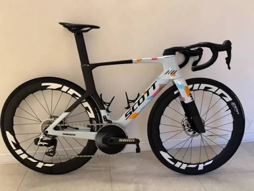
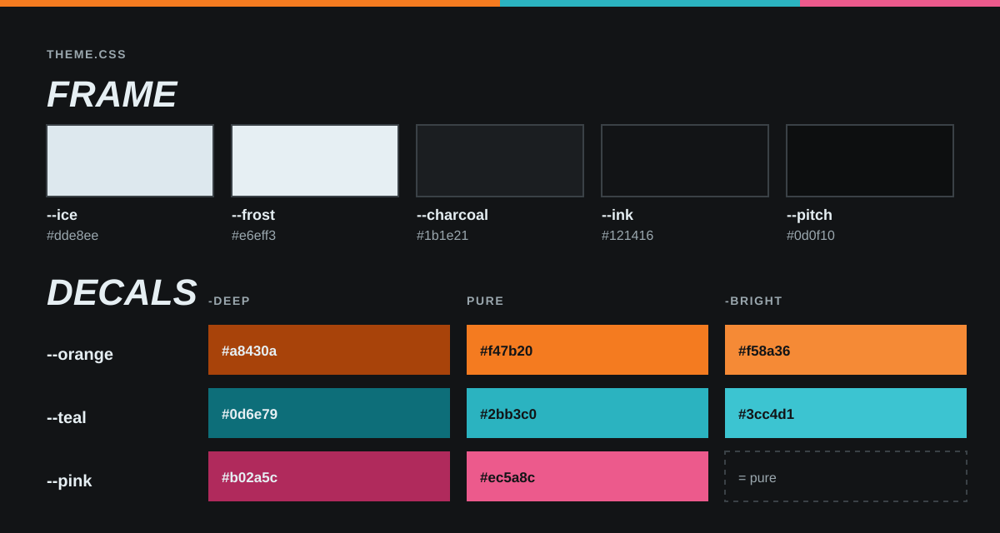
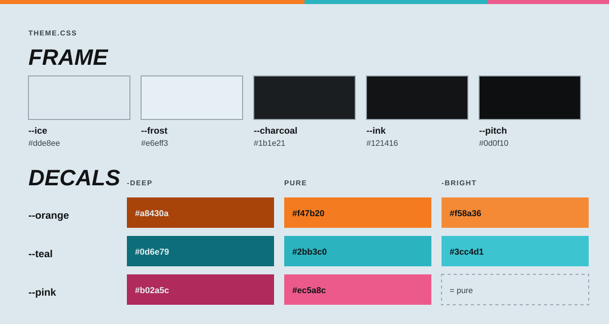
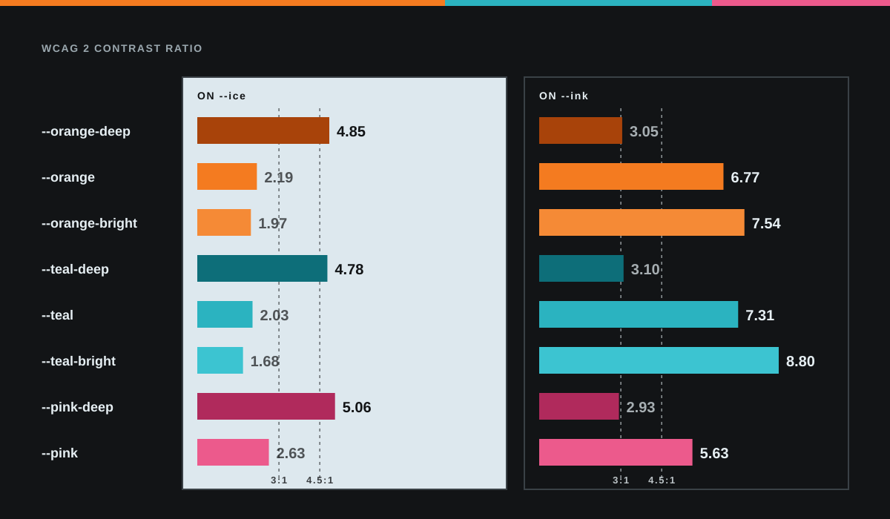
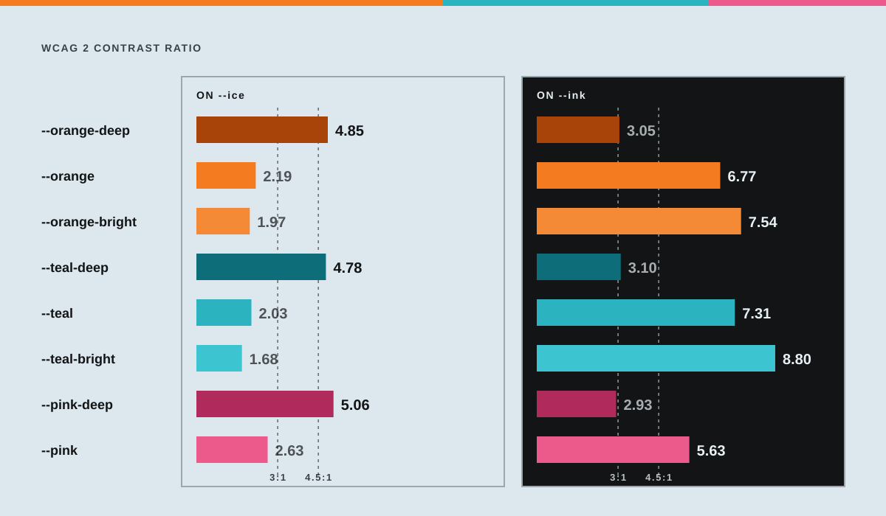
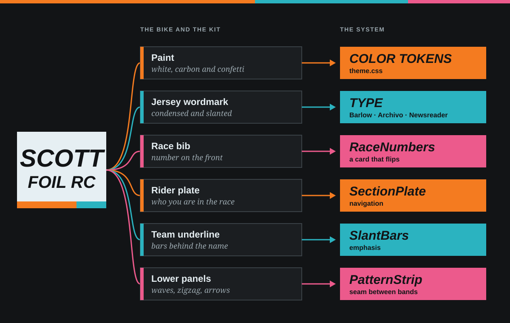
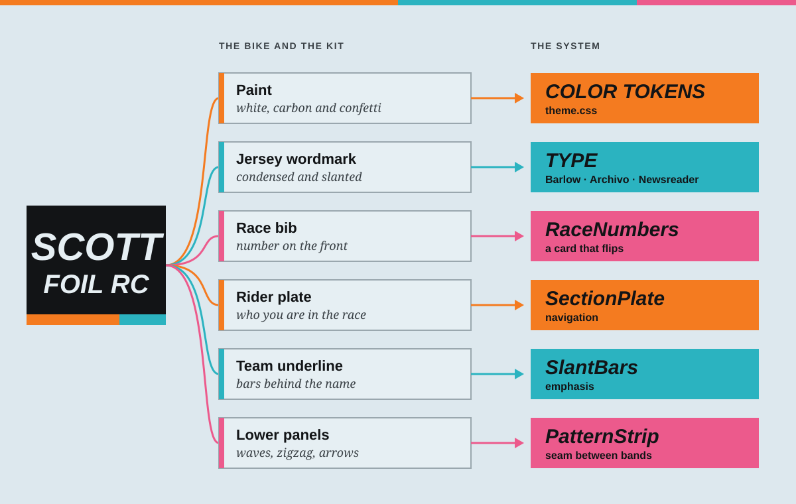
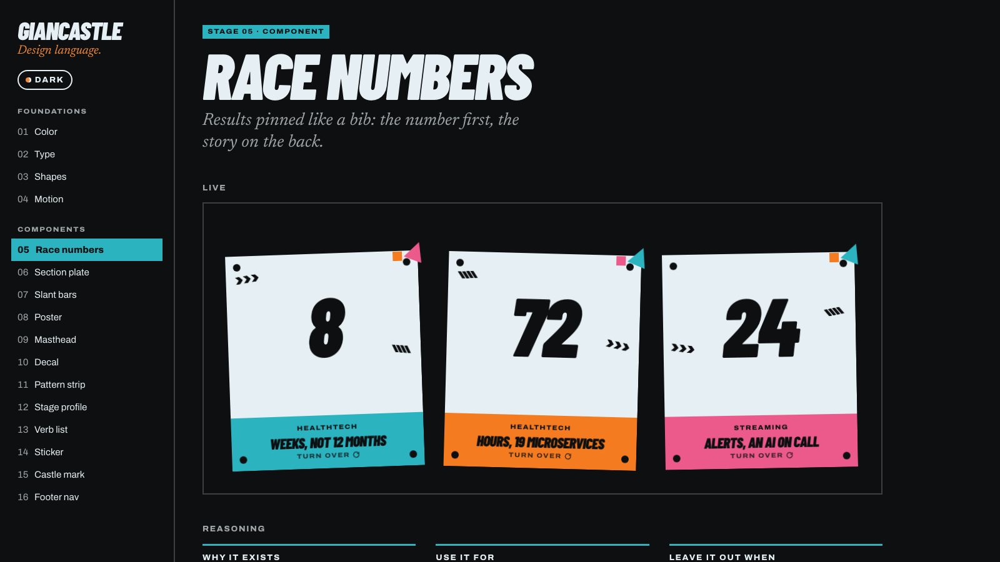
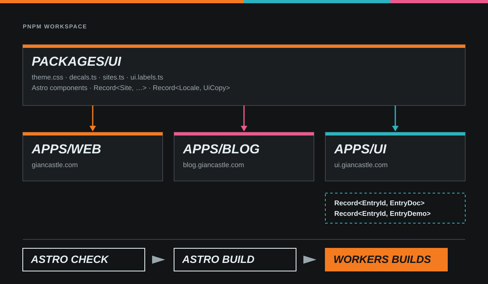
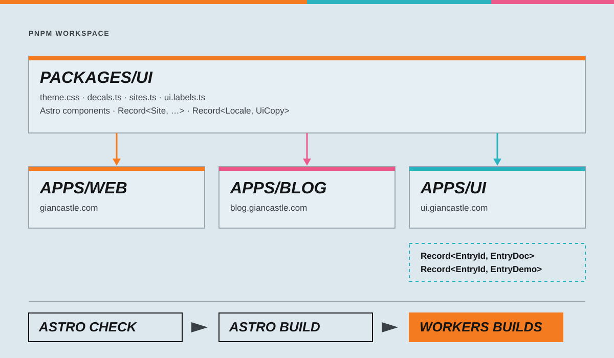

If you scroll all the way to the bottom of this site's home page you'll find a line half hidden there. _Frame: Astro. Groupset: TypeScript. Paint: off a Scott Foil RC._

It's not an inside joke (well, a little bit). It's probably the most honest line in the whole project. The colors you see here didn't come from a generated palette or a Pinterest board... **they came from my bike**.

In this post I'll tell you why I like that look so much, how I turned it into a system three sites now share ([giancastle.com](https://giancastle.com), this blog and [ui.giancastle.com](https://ui.giancastle.com)) and which engineering decisions keep it from falling apart over time.

## So, why the Scott?



My Scott is a race bike, and on a race bike nothing is extra. Look at it this way. The front triangle is white, the seat tube and the wheels are black carbon, and on top of the white falls a confetti of color with orange, teal, pink and a hint of yellow.

That's what hooks me. It isn't a decorated look, it's a look with **hierarchy**. The base is black and white, and color only shows up where it has something to say.

> Almost everything is frame, and color earns its place.

That ended up being the rule of the site. Orange marks the one thing I want you to do, like the section you're in or the button to email me. Teal is the second voice. And pink... pink is the one you see least, and that's how it should be. I left yellow out on purpose, because three accents are already enough to keep the hierarchy.

## I'm not the only one

To be honest, these colors aren't my invention either. Orange and teal is one of the most used pairs out there. In film it has ruled action movies for years, and the reason is pretty technical. Skin falls in the orange range, so pushing the shadows toward teal separates people from the background. They're almost opposite on the color wheel, and that's why one makes the other shine.

In product you see it every day. Go to Amazon this Black Friday and it's orange from edge to edge, with a dark, almost green teal as the second voice on the deal cards. Careful though, Amazon does exactly the opposite of my rule. There orange is the frame, not the accent, because its job is to make everything shout "deal". Same pair of colors, different hierarchy, different goal. GoDaddy, in its 2020 rebrand, kept teal on black and white. And if you look at cycling kits from the last few years, the pattern repeats, with a neutral base and loud accents.

What I cared about wasn't following a trend, but understanding **why** it works so I could use it with judgment.

## From frame to tokens



The bike gave me the mapping almost for free. The white of the frame became the `plain` tone and the carbon became the `contrast` tone. Every section declares which one it lives in, and components never pick their own background, they just read `--bg` and `--fg` from the tone they land in. The decision has a cost (you can't paint a component "just because") but in exchange the same component works on a light band, a dark band and in both themes without a single condition.

Now, here's the part nobody tells you. Paint doesn't translate straight into CSS. Pure orange on a light background fails contrast for text, and a dark teal disappears on charcoal. So every color has three versions, the pure one for solid fills, a deep one for text on light surfaces and a bright one for text on dark surfaces.

Does it actually work? I measured it for this post.



The bright variants go from 5.63 to 8.80 on the dark surface, well above the 4.5 WCAG AA asks for. The deep ones on the light surface pass too... now. When I first measured, deep teal (`#0e7480`) landed at **4.40**, just under the line. I found it while writing this post.

The fix? Lower the lightness without touching the hue, down to `#0d6e79`, which gives **4.78**. There was an option that passed at 4.52, but a token that passes by two hundredths breaks with the first background tweak, so I gave it the same margin as deep orange (4.85). A one-line change in `theme.css`, and all three sites inherit it on the next deploy. That's what the system is for.

## The type of a jersey

If you pay attention, many pro teams speak in three voices. A huge name, condensed and slanted. Small, wide labels for the sponsors. And very often, under the name, a thin serif line that competes with nothing.

I copied that structure as is, no shame. Barlow Condensed in black italic for the shout, meaning headlines, numbers and verbs. Wide, bold Archivo for labels. And Newsreader in italic for the line underneath, like the _Senior Product Engineer._ under my name on the home page. The serif is rationed, one line per section at most, because if everything whispers nothing gets heard.

## Studying a real kit

Colors were the start, but I wanted to go further. So I sat down to study the visual language of the NSN team on Instagram, how they put together their announcements, their kits and their race numbers. Not to copy anything, but to understand which devices they kept repeating and why they worked.



Four pieces came out of that, and they're components now.

**Race numbers.** The results of my work became bibs. The number goes big on the front, with a color band at the bottom like a real bib, and the full story is on the back. If you care, you turn it over. And this stopped being just a metaphor. I recently started racing some of the biggest events in my country, like the Triple 100, so now I've got real bibs too.



**The plate.** Navigation is a numbered plate that drops in as you scroll and tells you which section you're in, like a rider's number. On the blog and the design site it stays in its short form, with only the other sites.

**Slant bars.** Two offset bars, orange and teal, behind the line that matters. It's the trick teams use to underline a rider's name.

**Pattern strips.** Four panels between sections with solid color, waves, zigzag and arrows. They come from the lower panels of a jersey and make the change from a dark band to a light one feel like a seam instead of a cut.

## A system, not a pile of styles

As an engineer, what mattered most to me was that this didn't end up as a CSS file full of loose colors (we've all seen one of those). The rule was simple. **One source of truth**, and let the compiler defend it.



Everything lives in a shared package the three sites consume. Colors, shapes, labels and sites are typed records, so if tomorrow I add a new site it shows up on its own in the plate and the footer of all three.

The design site takes the same idea one step further. Every documented piece is an entry in a registry, and its text and demo are tied to that list with a `Record`.

```ts
export const COMPONENT_DOCS: Record<ComponentId, EntryDoc> = {
  [COMPONENT.raceNumbers]: { title: 'Race numbers' /* ... */ },
  [COMPONENT.sectionPlate]: { title: 'Section plate' /* ... */ },
  // add an id without documenting it and this won't compile
};
```

Why a `Record` and not an array? Because an array is fine with a missing item and a `Record` isn't. If I add a component and don't document it, `astro check` fails, the build doesn't finish and Cloudflare doesn't deploy. The cost is a bit more ceremony when adding something new, and I'm happy to pay it.

> Documentation stops being a chore that gets forgotten and becomes a condition for shipping.

## Anyway

A design language doesn't start in Figma. It starts with something you like enough to look at closely and ask **why it works**. For me it was my own bike, and the answer was hierarchy. A neutral base, little color, and every color with a job.

The other thing I take away is to measure. I thought contrast was solved and the numbers told me not quite, and the fix was one line because the system was built right. A design system is code too, and code gets tested.

If you want to see every piece with its reasoning, it's all on [ui.giancastle.com](https://ui.giancastle.com). And if the same thing happens to you with something you love, that's my advice... look at it closely, it probably has something to teach you.
