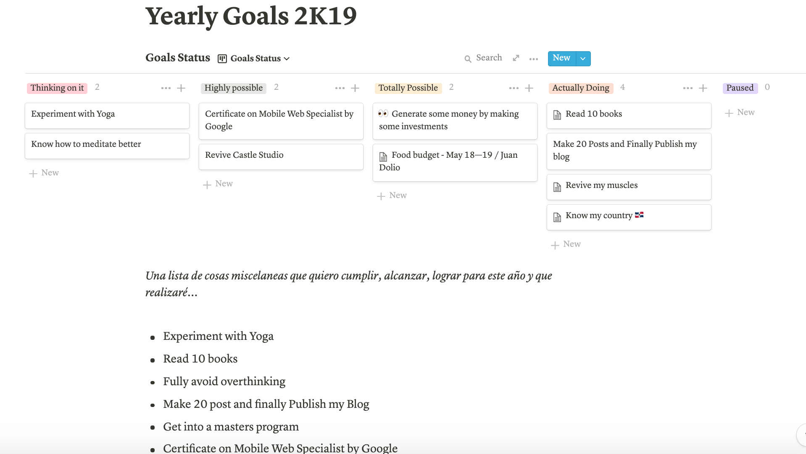

In early December, I had dinner with a colleague and we started talking about our New Year's resolutions. I told him that every year I write a long list of things I try to accomplish for the year.

> "So your resolutions are like a to-do list," he observed.

*Part of my enormous to-do list from last year*

> -  "I guess that's true," I said. "What's your resolution?"

> - "This is going to sound kind of ridiculous, but my resolution is to be kinder to myself," he said.

I stayed there thinking for a few seconds and exclaimed:
> - "I see, I liked that... that's the move".

With my friend's permission, and aware that my previous "to-do list" approach hadn't worked in any year before this one, I've replaced my litany with this much more succinct commitment: I will strive to be kind to myself. And I'd recommend this goal to anyone who has already slipped up on a resolution made this New Year, and I figure that in one thing or another, we all fail at some of our resolutions.

After all, how many of us have wasted unnecessary energy on self-criticism when we don't make it to the gym as often as we'd like, when we sleep in on the weekend, or when we allow ourselves a few extra calories? We can all work on establishing new, healthier habits in this new year, but here are a few simple ways to put self-care at the top of your list.

## Embrace self-compassion

Most of us, especially at this time of year, fixate on our flaws. We think about what we still have to accomplish, about what we promised we'd finish but didn't, or about what we swore we wouldn't do but did, about those unmet goals, the unread books and the professional goals that have yet to be reached.

Instead of concentrating on what you haven't finished, on what you failed at, embrace self-compassion instead, defined simply as your ability to accept your flaws with kindness and understanding. I read a famous quote by *Kristen Neff* that said...

> Having compassion for yourself means that you honor and accept your humanness.

Things won't always go the way you want. You'll run into frustrations, losses will happen, you'll make mistakes, you'll bump up against your limitations, you'll fall short of your goals. This is our condition as humans, a reality shared by all of us.

To find out how self-compassionate you are, test yourself using Neff's self-compassion scale. Then you can work on increasing your self-compassion using some of the exercises available on her website.

## Quiet the critic you carry inside

Chances are you're very familiar with your inner critic and her tendency to belittle you: she's the one who tells you you're not thin enough or smart enough. If you let her, she'll keep you up at night with an endless list of all the things you did wrong that day.

But it turns out that quieting your inner critic is good for your mental health. Research shows that self-compassion leads to self-reported feelings of happiness, optimism and curiosity.

It may not be possible to silence her completely, but you can start to recognize your inner critic when she behaves inappropriately. Change the language she uses. Instead of letting her say "you're lazy," encourage her to talk to you the way you'd talk to a good friend: "You had a rough day and you deserve to rest after work! You'll make it to the gym this weekend."

### Remember that you're imperfect, and that's perfectly fine

## Be kind to others

A recent study at the University of California, Berkeley, found that participants who were compassionate toward others were in turn more compassionate toward themselves. This makes sense: Once we're able to accept those around us, it's much easier to accept ourselves.

"If you want others to be happy, practice compassion," says the Dalai Lama. "If you want to be happy, practice compassion."

Research backs the Dalai Lama's sentiment: Kindness toward others leads to greater well-being. Want to get inspired? Take a look at the Random Acts of Kindness Foundation, which has a list of kindness ideas to get you started.

## Give yourself some leave

After New Year's, my colleague who made the resolution to be kinder to himself sent me a line on That Blessed Messaging App.

I got his note one afternoon when I was feeling especially drained and tired, but trying to get through a nasty flu.

> - "What's good, man. Were you kind to yourself today?" he said.

I read his note, remembered my resolution and smiled. Then, I filed my own leave request in Zoho (*inside joke*) to go to sleep.

Give yourself this kind of leave to be good to yourself in this new year. If you feel drained, go to sleep. If you feel stressed, take a break, slack off, chill... be more of a goofball. And if you feel discouraged because you haven't kept up enough with your resolutions or goals, remind yourself kindly: ***You are enough***. You can also give yourself a whack, in case you're one of those drastic people.
