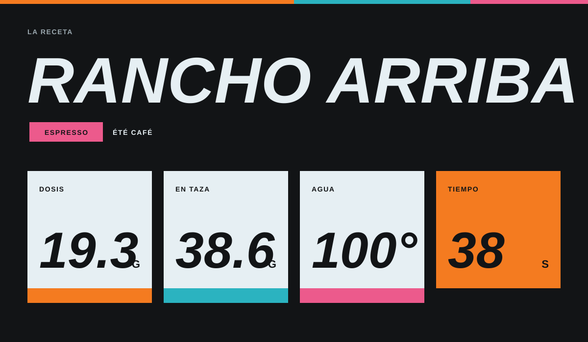
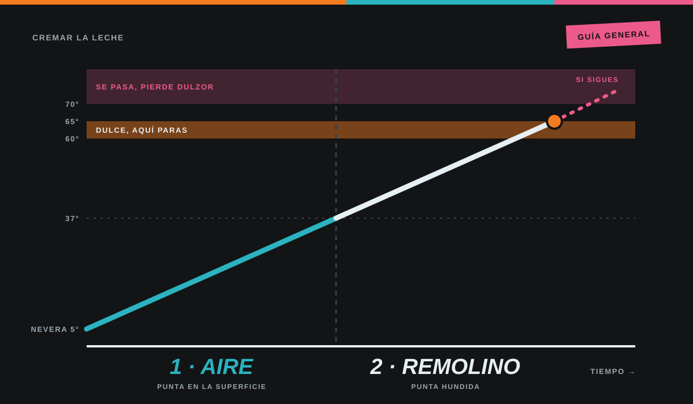
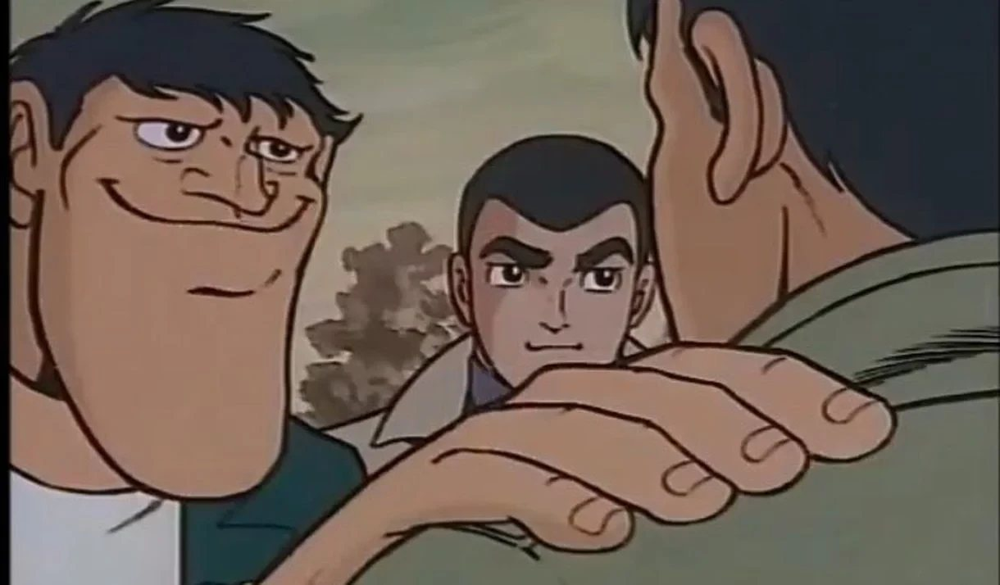

Soy fundamentalmente un loco con tres cosas... café, ciclismo y software.

Este post estrena una sección especial del blog, la [Parada de café](/tags/cafe/). Y es el primero donde documento mi proceso, cómo me he ido construyendo en este mundo como barista y cafetero wannabe.

En mi casa pasa algo curioso. La gente llega "a saludar" y a los cinco minutos ya está preguntando si hay café. Pero ojo, no el de greca... vienen por los **lattes**. Y no hablo solo de los cafeteros... hablo de gente que te dice de frente que el café no le gusta (y aun así se toma el suyo).

Con el tiempo he ido usando varios cafés que me llegan, pero el de siempre tiene nombre... y pa'l colmo se llama **E'te Café**, con origen en **Rancho Arriba**. En este post te cuento cómo llegué a un espresso dulce y suave, lo bastante noble como para echarle leche y servir un latte sin que el café se pierda. Te adelanto algo... no fue rápido ni fue bonito.

## A ver, ¿qué café es?

E'te Café es una cafetería y tostadora de Cambita, San Cristóbal, y este es su café de Rancho Arriba. Rancho Arriba queda en San José de Ocoa, en plena zona de montaña, y la funda te cuenta el resto. Viene de la finca Café Samir, en Mahoma, a 1000 metros de altura. Es un blend de proceso lavado y tueste medio, con notas **frutales y de chocolate**.

Esas dos notas son toda la historia. El chocolate es lo que quieres que se quede en la taza. Lo frutal es acidez, y una acidez mal llevada es lo primero que espanta a alguien que no toma café.

## Con qué lo hago

Mi máquina es una Rancilio Silvia. El molino es un Timemore Sculptor 064S y la balanza una Timemore mini, que me muestra el peso y el flujo en el tiempo.

Antes del Sculptor usaba un Baratza Encore. Es un buen molino para empezar y para el café de todos los días, pero para afinar un espresso se me quedaba corto.

## Los primeros tiros fueron horribles

No lo voy a adornar. El primero tardó una eternidad en salir y sabía a **carbón**.

Míralo así. Un espresso es agua caliente pasando a presión por café molido, y en ese rato tiene que llevarse lo bueno del grano. Si se lleva muy poco, la taza queda ácida y flaca. Si se lleva demasiado, queda amarga y seca. Lo dulce vive en el medio.

Un tiro que tarda una eternidad se lleva demasiado. Por eso mis primeros tiros vivían en la esquina amarga del mapa, bien lejos del centro.

Hubo días en que me rendí. Probé a ponerle azúcar de caña a la leche y hasta intenté espressos cubanos, que al final es otra forma de arreglarlo con azúcar. Y en el camino boté unas cuantas libras de Rancho Arriba. Bastantes.

## Afinar es depurar

Aquí es donde el ingeniero se me sale. Afinar un espresso es lo mismo que depurar un bug. Cambias **una sola cosa**, corres la prueba, lees el resultado y decides el próximo cambio. Si cambias tres cosas a la vez no aprendes nada (igualito que en el código).

Lo que más me costó fue la presión. La tuve que medir y ajustar a mano en la máquina, por recomendación de un amigo, y me tomó un buen rato entenderla porque es un proceso muy visual y muy artesanal. Aquí no hay un log que leer, hay que mirar el tiro. La dejé en unos 9.2 bares, estimados. Mi máquina tiene un pequeño desnivel y siento que ahí encontré el punto.

El otro cambio grande fue el molino. Con el Sculptor pude por fin mover la molienda en pasos pequeños, y eso es lo que te deja acercarte al centro del mapa en vez de saltarlo de un lado a otro.

> Mide, no asumas. Vale para un contraste de color y vale para una taza de café.

## La receta

Son 19.3 gramos de café en una canasta plana, agua a 100° y **38 segundos** de extracción, sin preinfusión. En la taza quedan 38.6 gramos, o sea un ratio de 1 a 2 clavado.

Treinta y ocho segundos es más de lo que recomienda casi cualquier guía, y es a propósito.

Al dejar correr la extracción unos segundos más, no es que elimines el ácido que ya cayó en la taza, sino que lo diluyes y lo equilibras extrayendo más cuerpo y amargor. Para alguien que no está acostumbrado al espresso (que suele asociar la acidez con algo agrio o desagradable), esto hace que la bebida sea mucho más amigable.

Ahí está el truco para la gente que "no toma café". No les cambié el café, **les quité el susto**.

Tengo un amigo que nunca ha sido de café. Cada vez que me visita me pide uno, y siempre me dice lo mismo, que el mío sí se lo puede tomar sin problema. Para mí no hay mejor puntaje para una taza.

## El perfil del tiro

Una receta te dice dónde terminó el tiro. El perfil te dice cómo llegó. Mi balanza muestra el peso y el flujo segundo a segundo, y esa es la forma más honesta de saber si dos tiros fueron de verdad iguales.

No guardé la curva de la balanza, así que esta la reconstruí de la receta. Los extremos son reales, 38.6 gramos a los 38 segundos, y eso da un flujo promedio de más o menos **un gramo por segundo**. Un tiro de verdad no sale en línea recta (arranca lento y se va soltando), pero como referencia me sirve. Si el próximo tiro llega a los 38.6 gramos mucho antes o mucho después, algo cambió.

## Dulce y suave

¿Y cómo sé que llegué? Porque la taza cambió de forma.

Esto no es una cata con puntajes, es mi memoria dibujada. Los primeros eran puro amargor y casi nada de dulce. El de hoy es dulce y suave, con el chocolate al frente y lo frutal acompañando sin pelear.

## Y por fin, la leche

Esta parte tiene nombre y apellido. El día de nuestra boda le prometí a mi esposa que le iba a servir un latte todos los días, porque el café fue una de las cosas que nos unió. He tratado de cumplirlo (obviamente ha habido días en que no se ha podido).

Así que el espresso era solo la mitad del trabajo. La leche sigue siendo un trabajo en progreso. Estoy probando literalmente todas las que encuentro, y la que mejor me ha funcionado hasta ahora es la **Président entera**.

Cremar la leche parece fácil hasta que lo intentas. A mí me costó muchísimo aprender a texturizar, y te confieso algo... prácticamente todo lo aprendí viendo Reels.

La idea es meterle aire al principio, con la punta de la lanceta apenas debajo de la superficie (suena como papel rasgándose), y después hundirla un poco para que la leche gire en remolino y esas burbujas se vuelvan una crema fina. Si te pasas de aire te queda pura espuma, y si te pasas de calor la leche pierde el dulzor. Yo empecé con un termómetro, pero con el tiempo logré leer la temperatura con la mano.

Con la Silvia hay un detalle más. Tiene una sola caldera, así que no puedes sacar el tiro y cremar al mismo tiempo. Yo saco primero el tiro y después cremo.

Una leche bien cremada pone dulzor y cuerpo, pero también tapa. Por eso el espresso tenía que llegar primero. El latte que me sale hoy es **muy dulce sin ser demasiado lechoso**, y el café todavía se siente detrás.

Ella, por cierto, lo prefiere con leche de avena, y tiene sentido. La avena es mucho más neutra y deja pasar mejor el sabor y las notas del espresso.

## Pásate por E'te Café

Si este café te dio curiosidad, tienes que conocer a quienes lo tuestan. **E'te Café** es una cafetería y tostaduría de café de especialidad dominicano en Cambita, San Cristóbal, en el segundo piso de un casón. Ojo, abren solo los fines de semana. 100% recomendados si quieres pasarte una tarde en vacanería, chercha y café con galletas (todavía no supero las galletas que probé la última vez que fui).

Y no lo digo solo yo. Quedaron entre las 100 mejores cafeterías de Norteamérica, Centroamérica y el Caribe, en el puesto 87, y son una de las cuatro dominicanas de esa lista.

Los encuentras en Instagram como [@ete.cafe](https://www.instagram.com/ete.cafe/).

## En fin

No soy barista, soy alguien al que le encanta entender por qué las cosas funcionan. Y lo que me llevo de esto es que un buen café no se adivina... **se mide, se prueba y se ajusta**. Una cosa a la vez.

Si pasas por mi casa, eso e' lo que hay.

