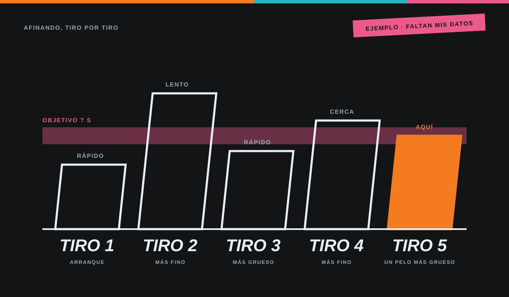

En mi casa pasa algo curioso. La gente llega "a saludar" y a los cinco minutos ya está preguntando si hay café. Y no hablo solo de los cafeteros... hablo de gente que te dice de frente que el café no le gusta (y aun así se toma el suyo, y a veces repite).

Ese café tiene nombre. Es el **Rancho Arriba de Été Café**, y en este post te cuento cómo lo llevé a un espresso dulce y suave, lo bastante noble como para que por fin pudiera echarle leche y hacer un latte o un cappuccino sin que se me perdiera en el camino.

> Aviso de borrador. Todo lo que ves marcado <mark>así</mark> es un dato que todavía tengo que llenar yo, y los gráficos con la etiqueta rosada son de ejemplo.

## A ver, ¿qué café es?

Rancho Arriba queda en San José de Ocoa, en plena zona de montaña, y es una de las zonas cafetaleras conocidas del país. De ahí viene este café.

<mark>P1 · Lo que dice la funda. Nivel de tueste, notas de cata, proceso, variedad y altura.</mark>

Lo que me atrapó fue <mark>P1 · por qué elegí este café y no otro</mark>.

## El problema con un espresso claro

Míralo así. Un espresso es agua caliente pasando a presión por café molido durante unos segundos, y en ese rato tiene que llevarse lo bueno del grano. Si se lleva muy poco, la taza queda **ácida** y flaca. Si se lleva demasiado, queda **amarga** y seca. Lo dulce vive en el medio.

Con un café de tueste claro el reto es mayor, porque el grano es más denso y suelta menos de lo suyo en el mismo tiempo. Por eso es tan fácil terminar en la esquina ácida del mapa. Y ahí la leche no perdona. Un tiro ácido con leche no sabe a latte, sabe a que algo salió mal.

Eso fue lo que me pasó al principio. <mark>P5 · Cómo sabían mis primeros tiros y qué pasaba cuando les echaba leche.</mark>

## La receta

Después de varios intentos, esta es la receta con la que me quedé.

<mark>P3 · Dosis, gramos en taza, tiempo y temperatura. También la canasta que uso.</mark>

¿Por qué esos números? <mark>P3 · La razón detrás de la receta, por ejemplo un ratio más largo o agua más caliente.</mark>

## El perfil del tiro

Una receta te dice dónde terminó el tiro. El perfil te dice **cómo llegó**. Es la presión, el flujo y el peso segundo a segundo, y es el gráfico con el que el mundo del espresso se explica a sí mismo.

<mark>P2 · Mi máquina, mi molino y mi balanza, y si alguno me da esta curva.</mark>

<mark>P4 · Si hago preinfusión o algún truco con la presión o el flujo, y qué le hace a la taza.</mark>

## Afinar es depurar

Aquí es donde el ingeniero se me sale. Afinar un espresso es lo mismo que depurar un bug. Cambias **una sola cosa**, corres la prueba, lees el resultado y decides el próximo cambio. Si cambias tres cosas a la vez no aprendes nada (igualito que en el código).

<mark>P6 · Qué fui cambiando, en qué orden y cuántos tiros me tomó llegar.</mark>

> Mide, no asumas. Vale para un contraste de color y vale para una taza de café.

## Dulce y suave

¿Y cómo sé que llegué? Porque la taza cambió de forma.

<mark>P7 · Cómo sabe ahora, con mis palabras, y una nota del 1 al 10 en cada atributo para el primer tiro y para el bueno.</mark>

## Y por fin, la leche

Esta era la meta desde el principio. La leche vaporizada pone dulzor y cuerpo, pero también tapa. Si el espresso llega flojo, desaparece. Si llega ácido, pelea con ella. Tiene que llegar dulce y con suficiente carácter para que se sienta **detrás** de la leche.

<mark>P8 · Qué leche uso, cuánta, si es latte o cappuccino, y qué fue lo que antes no me salía.</mark>

Y aquí vuelve la gente del principio. <mark>P9 · La anécdota de alguien que no toma café y se tomó el mío, y lo que dijo.</mark>

## En fin

No soy barista, soy alguien al que le encanta entender por qué las cosas funcionan. Y lo que me llevo de esto es que un buen café no se adivina... **se mide, se prueba y se ajusta**. Una cosa a la vez.

Si pasas por casa, ya sabes lo que hay.
