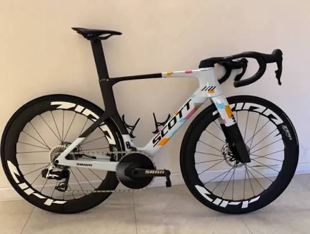
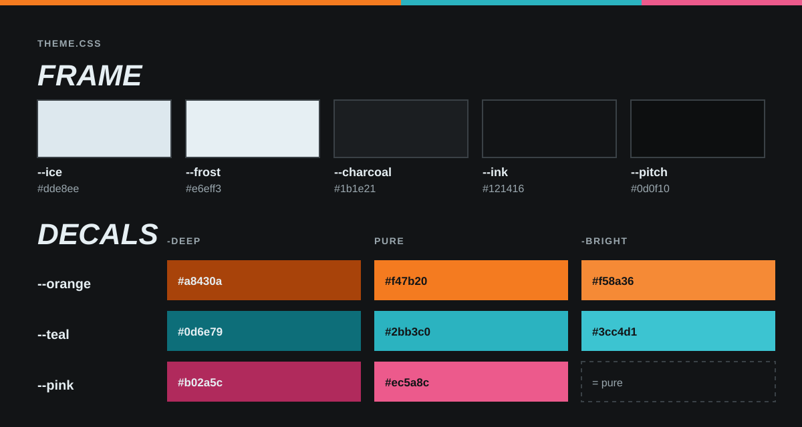
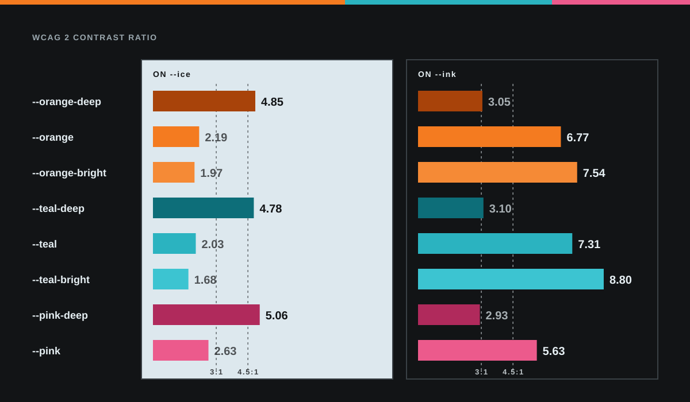
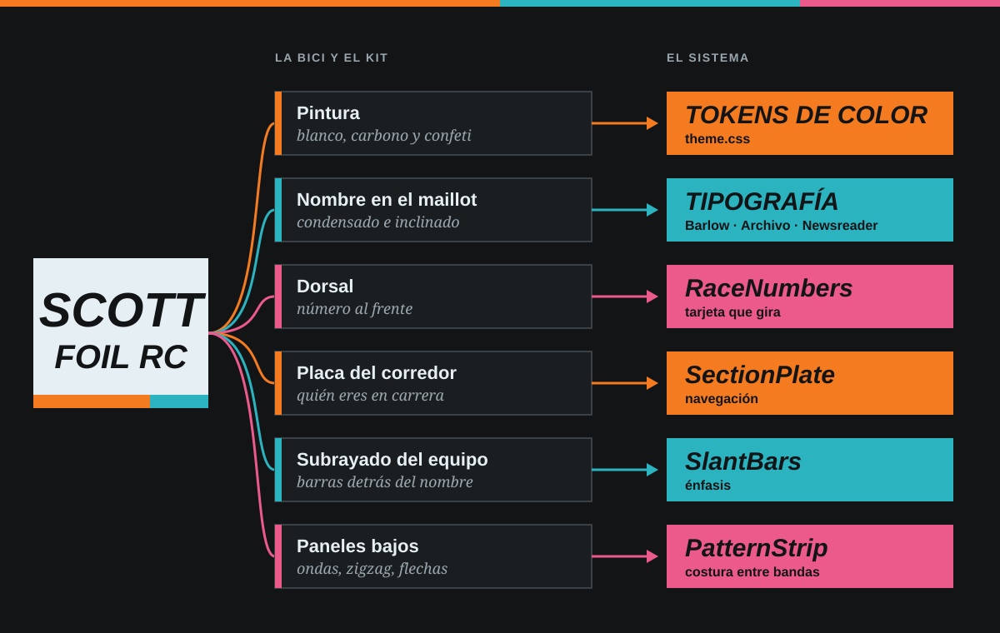
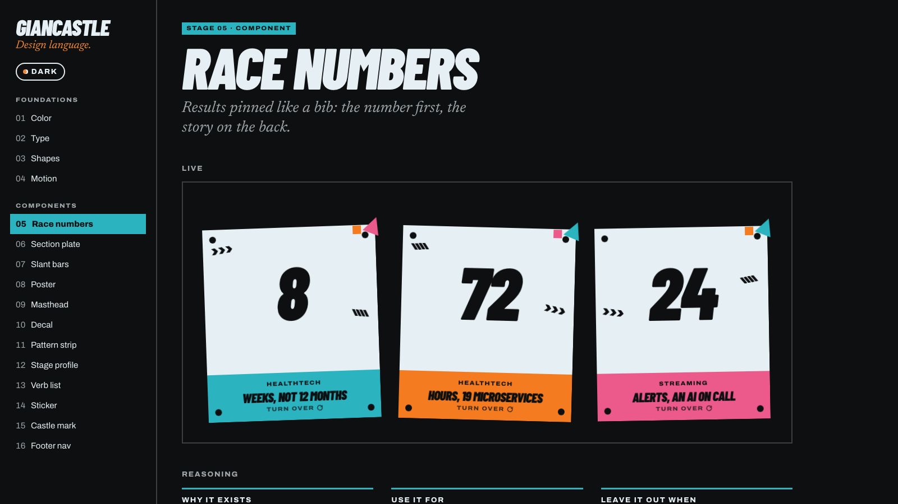
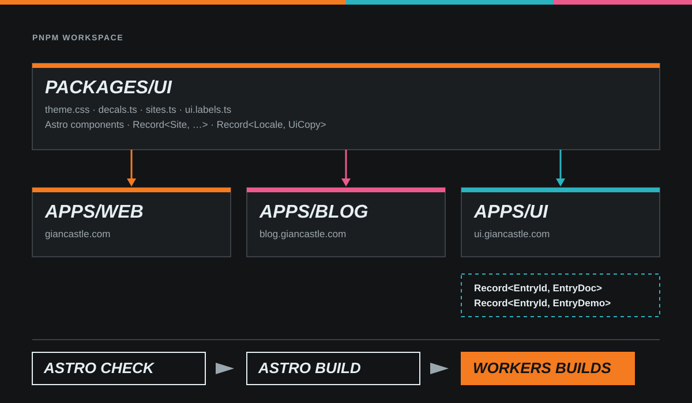

Si bajas hasta el final de la portada de este sitio vas a encontrar una frase medio escondida. _Cuadro: Astro. Grupo: TypeScript. Pintura: de una Scott Foil RC._

No es un chiste interno (bueno, un poquito sí). Es probablemente la frase más honesta de todo el proyecto. Los colores que ves aquí no salieron de una paleta generada ni de un tablero en Pinterest... **salieron de mi bici**.

En este post te cuento por qué me gusta tanto esa estética, cómo la convertí en un sistema que hoy comparten tres sitios ([giancastle.com](https://giancastle.com), este blog y [ui.giancastle.com](https://ui.giancastle.com)) y qué decisiones de ingeniería hay detrás para que no se rompa con el tiempo.

## A ver, ¿por qué la Scott?



Mi Scott es una bici de carrera, y en una bici de carrera nada sobra. Míralo así. El triángulo delantero es blanco, el tubo del sillín y las ruedas son carbono negro, y encima del blanco cae un confeti de color con naranja, turquesa, rosa y algún toque de amarillo.

Eso es lo que me atrapa. No es una estética decorada, es una estética con **jerarquía**. La base es blanco y negro, y el color solo aparece donde tiene algo que decir.

> Casi todo es cuadro, y el color se gana su lugar.

Esa terminó siendo la regla del sitio. El naranja marca lo único que quiero que hagas, como la sección en la que estás o el botón para escribirme. El turquesa es la segunda voz. Y el rosa... el rosa es el que menos ves, y así debe ser. El amarillo lo dejé fuera a propósito, porque tres acentos ya son suficientes para mantener la jerarquía.

## No soy el único

Te soy honesto, estos colores tampoco son un invento mío. Naranja con turquesa es una de las parejas más usadas que existen. En cine lleva años dominando las películas de acción, y la razón es bastante técnica. La piel cae en el rango del naranja, así que empujar las sombras hacia el turquesa separa a las personas del fondo. Son casi opuestos en el círculo cromático, y por eso uno hace brillar al otro.

En producto lo ves todos los días. Entra a Amazon este Black Friday y vas a ver naranja de punta a punta, con un turquesa oscuro, casi verde, como segunda voz en las tarjetas de ofertas. Ojo, Amazon hace justo lo contrario de mi regla. Allá el naranja es el cuadro y no el acento, porque su trabajo es que todo grite "oferta". Mismo par de colores, otra jerarquía, otro objetivo. GoDaddy, en su cambio de marca de 2020, se quedó con el turquesa sobre negro y blanco. Y si te fijas en los kits de ciclismo de los últimos años, el patrón se repite, con una base neutra y acentos ruidosos.

Lo que me interesaba no era seguir una tendencia, sino entender **por qué** funciona para poder usarla con criterio.

## Del cuadro a los tokens



La bici me dio el mapeo casi gratis. El blanco del cuadro se volvió el tono `plain` y el carbono se volvió el tono `contrast`. Cada sección declara en cuál vive, y los componentes nunca eligen su fondo, simplemente leen `--bg` y `--fg` del tono donde caen. La decisión tiene un costo (no puedes pintar un componente "porque sí") pero a cambio el mismo componente funciona en una banda clara, en una oscura y en los dos temas sin una sola condición.

Ahora, aquí viene la parte que nadie te cuenta. La pintura no se traduce directo a CSS. Un naranja puro sobre fondo claro no pasa contraste para texto, y un turquesa oscuro desaparece sobre carbón. Por eso cada color tiene tres versiones, la pura para rellenos sólidos, una profunda para texto sobre fondos claros y una brillante para texto sobre fondos oscuros.

¿Y eso funciona de verdad? Lo medí para este post.



Las variantes brillantes van de 5.63 a 8.80 sobre el fondo oscuro, muy por encima del 4.5 que pide WCAG AA. Las profundas sobre el fondo claro también pasan... ahora. Cuando lo medí por primera vez, el turquesa profundo (`#0e7480`) se quedaba en **4.40**, apenas por debajo de la línea. Lo encontré escribiendo este post.

¿El arreglo? Bajar la luminosidad sin tocar el tono hasta `#0d6e79`, que da **4.78**. Había una opción que pasaba con 4.52, pero un token que pasa por dos centésimas se rompe con el primer ajuste de fondo, así que preferí dejarlo con el mismo margen que el naranja profundo (4.85). Un cambio de una línea en `theme.css`, y los tres sitios lo heredan en el próximo despliegue. Para eso es el sistema.

## La tipografía de un maillot

Si te fijas, muchos equipos profesionales hablan con tres voces. Un nombre enorme, condensado e inclinado. Etiquetas pequeñas y anchas para los patrocinadores. Y casi siempre, debajo del nombre, una línea fina en serif que no compite con nada.

Copié esa estructura tal cual, sin pena. Barlow Condensed en negra cursiva para el grito, o sea titulares, números y verbos. Archivo ancho y en negrita para las etiquetas. Y Newsreader en cursiva para la línea de abajo, como el _Senior Product Engineer._ bajo mi nombre en la portada. La serif está racionada, una línea por sección como mucho, porque si todo susurra nada se escucha.

## Estudiar un kit de verdad

Los colores eran el comienzo, pero quería ir más allá. Así que me senté a estudiar el lenguaje visual del equipo NSN en Instagram, cómo arman sus anuncios, sus kits y sus dorsales. No para copiar nada, sino para entender qué recursos repetían una y otra vez y por qué funcionaban.



De ahí salieron cuatro piezas que hoy son componentes.

**Dorsales.** Los resultados de mi trabajo se volvieron números de carrera. El número va grande al frente, con una banda de color abajo como en un dorsal de verdad, y la historia completa está al dorso. Si te interesa, le das la vuelta. Y esto dejó de ser solo una metáfora. Hace poco empecé a correr en algunas de las carreras más destacadas del país, como la Triple 100, así que ahora también tengo dorsales de los de verdad.



**La placa.** La navegación es una placa numerada que aparece cuando bajas y te dice en qué sección estás, como el número de un corredor. En el blog y en el sitio de diseño se queda en su forma corta, solo con los otros sitios.

**Barras inclinadas.** Dos barras desplazadas, naranja y turquesa, detrás de la frase que importa. Es el truco con el que los equipos subrayan el nombre de un corredor.

**Franjas de patrón.** Cuatro paneles entre secciones con color liso, ondas, zigzag y flechas. Vienen de los paneles bajos de un maillot y hacen que el paso de una banda oscura a una clara se sienta como una costura y no como un corte.

## Un sistema, no un montón de estilos

Como ingeniero, lo que más me importaba era que esto no terminara en un archivo de CSS lleno de colores sueltos (todos hemos visto uno de esos). La regla fue simple. **Una sola fuente de verdad**, y que el compilador la defienda.



Todo vive en un paquete compartido que consumen los tres sitios. Los colores, las formas, las etiquetas y los sitios son registros tipados, así que si mañana agrego un sitio nuevo aparece solito en la placa y en el pie de página de los tres.

El sitio de diseño lleva la misma idea un paso más allá. Cada pieza documentada es una entrada de un registro, y su texto y su demo están atados a esa lista con un `Record`.

```ts
export const COMPONENT_DOCS: Record<ComponentId, EntryDoc> = {
  [COMPONENT.raceNumbers]: { title: 'Race numbers' /* ... */ },
  [COMPONENT.sectionPlate]: { title: 'Section plate' /* ... */ },
  // si agrego un id y no lo documento, esto no compila
};
```

¿Por qué un `Record` y no un arreglo? Porque un arreglo acepta que te falte un elemento y un `Record` no. Si agrego un componente y no lo documento, `astro check` falla, el build no termina y Cloudflare no despliega. El costo es un poco más de ceremonia al agregar algo nuevo, y lo pago con gusto.

> La documentación deja de ser un deber que se olvida y pasa a ser una condición para publicar.

## En fin

Un lenguaje de diseño no empieza en Figma. Empieza en algo que te gusta lo suficiente como para mirarlo de cerca y preguntarte **por qué funciona**. En mi caso fue mi propia bici, y la respuesta fue jerarquía. Una base neutra, poco color, y cada color con un trabajo.

Lo otro que me llevo es medir. Pensé que el contraste estaba resuelto y los números me dijeron que no del todo, y el arreglo fue una línea porque el sistema estaba bien armado. Un sistema de diseño también es código, y el código se prueba.

Si quieres ver cada pieza con su razonamiento, está todo en [ui.giancastle.com](https://ui.giancastle.com). Y si te pasa lo mismo con algo que te encanta, mi consejo es ese... míralo de cerca, seguro tiene algo que enseñarte.
